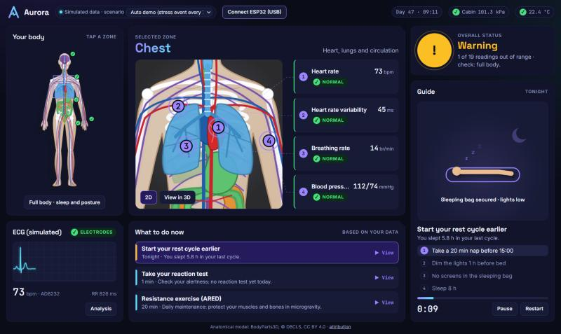

<p align="center"></p>

# Aurora · astronaut health monitor

**NASA Space Apps Challenge 2026 · Health Monitoring Software**

Aurora is a health monitor for long-duration missions, where there is no doctor on board and communication with Earth is delayed. An ESP32 with real biometric sensors streams data over USB to a web app. The app:

- shows each vital sign pinned to the exact place on a 2D/3D anatomical body where it is measured, with a green/amber/red status, a trend line and a plain-language normal range;
- tells the astronaut what to do next, with an animated, timed guide.



## What's inside

| Folder | Contents |
|---|---|
| [`main/`](main), [`components/`](components) | ESP32 firmware (ESP-IDF): AD8232 ECG/sEMG at 200 Hz, GSR V1.2, NTC thermistor, BMP180, ADXL345 |
| [`webapp/`](webapp) | React + Vite web app: anatomical body (BodyParts3D), live ECG, cardiac analysis, recommendations, reaction-time test |
| [`tools/`](tools) | Serial and HTTP monitors to check the sensors without the app |
| [`docs/`](docs) | Parameter inventory, recommendation protocols, data sources, UX and visual design, brand (in Spanish) |

## Features

- **Live sensors over USB (Web Serial):**
  - ECG waveform at 200 Hz, beat-by-beat R-peak timing, heart rate every 2 s;
  - skin conductance (GSR), body temperature, cabin pressure, movement;
  - loose-electrode detection.
- **Cardiac analysis,** recomputed every 2 s ([`webapp/src/lib/hrv.js`](webapp/src/lib/hrv.js)):
  - HRV time domain: SDNN, RMSSD, SDSD, pNN50;
  - Poincaré SD1/SD2;
  - Baevsky stress index;
  - spectrum: VLF/LF/HF, LF/HF;
  - QTc: Bazett, Fridericia, Framingham;
  - ECG-derived respiration;
  - surface EMG: MAV, RMS, WL, mean frequency.
- **28 rule-based recommendations** with animated guides: breathing, hydration, cabin leak protocol, fall check with a 15 s countdown, 15-15 rule for low glucose, and more.
- **Reaction-time test** (5 tries, sleep-deprivation reference from *sleepstudy*).
- **14 demo scenarios** (fever, heat stress, cabin leak, fall, loose electrode…) for running without hardware.
- **Thresholds** grounded in clinical ranges and in open datasets: NASA OSDR Inspiration4 (OSD-575, OSD-569, OSD-817, OSD-573), MMASH, SWELL-KW, sleepstudy, Fitbit.

## Run the web app

```bash
cd webapp
npm install
npm run dev      # http://localhost:5173
npm test         # 32 checks of the HRV / QTc / EDR / sEMG formulas
```

To read the ESP32, open the app in **Chrome or Edge** (Web Serial) and click **Connect ESP32 (USB)**. Without hardware, the app runs on simulated data.

## Build and flash the firmware

Requires ESP-IDF 5.3+ (tested with 6.0.2).

```bash
idf.py set-target esp32
idf.py build flash -p COM14
```

On Windows, [`flash.ps1`](flash.ps1) does an incremental build in `idf6/` and flashes in one step.

- **Download mode:** if the board doesn't enter it automatically, hold **BOOT**, tap **EN**, then release **BOOT** before flashing.
- **WiFi:** it is off by default. To enable it, copy `main/wifi_credentials.example.h` to `main/wifi_credentials.h` and build with `-DAURORA_ENABLE_WIFI=ON`.

Serial protocol, pins and calibration: [`docs/FIRMWARE.md`](docs/FIRMWARE.md).

## Credits and licenses

- **3D anatomical model:** [BodyParts3D](https://dbarchive.biosciencedbc.jp/en/bodyparts3d/) © The Database Center for Life Science (DBCLS), **CC BY 4.0**. Details in [`webapp/public/ATTRIBUTION.md`](webapp/public/ATTRIBUTION.md).
- **Datasets:** sources and links in [`docs/LINKS_USADOS.md`](docs/LINKS_USADOS.md). The datasets themselves are not included in this repository.
- **Not a medical device:** Aurora is an educational prototype built for a hackathon, not a clinical tool.
