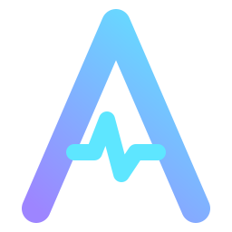
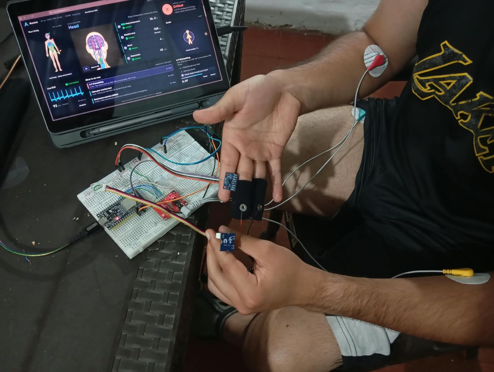
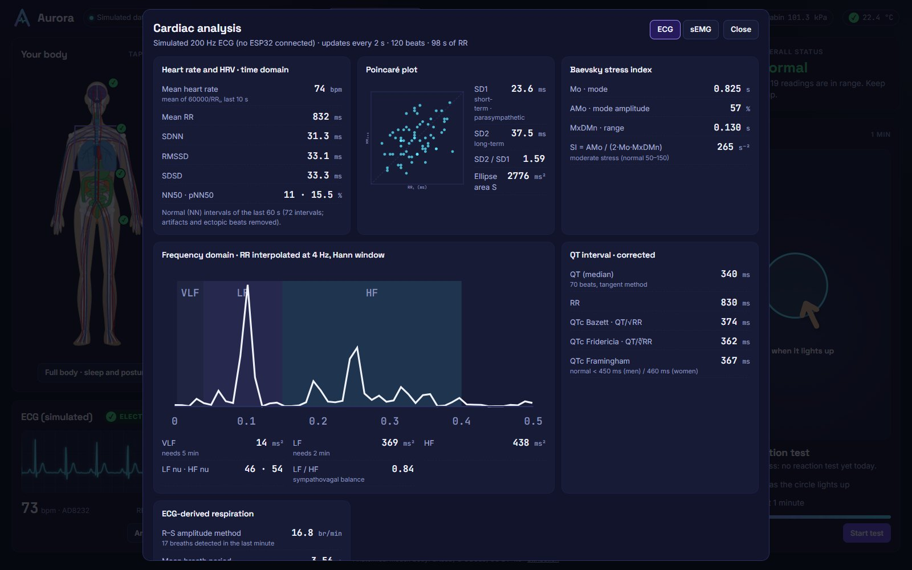
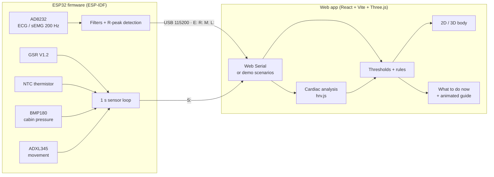

<p align="center"></p>

<h1 align="center">Aurora · astronaut health monitor</h1>

<p align="center">
  <b>NASA Space Apps Challenge 2026 · Health Monitoring Software</b><br>
  Real biometric sensors on an ESP32 + a web app that shows every reading on the body and says what to do next.
</p>

<p align="center">
  
  
  
  
</p>


## Contents

- [The problem](#the-problem)
- [What Aurora does](#what-aurora-does)
- [Demo](#demo)
- [How it works](#how-it-works)
- [Features](#features)
- [Repository layout](#repository-layout)
- [Run the web app](#run-the-web-app)
- [Build and flash the firmware](#build-and-flash-the-firmware)
- [Data sources](#data-sources)
- [Credits and license](#credits-and-license)

## The problem

On a long mission there is no doctor on board, and a message to Earth can take minutes to arrive. The crew has to notice a health problem early and act on it themselves, often without medical training.

## What Aurora does

- **Measures** heart (ECG at 200 Hz), skin conductance, body temperature, movement and cabin pressure with real sensors.
- **Shows** each reading pinned to the place on a 2D/3D anatomical body where it is measured, with a ✓ / ! / ✕ status, a trend line and the normal range in plain words.
- **Tells the crew what to do next:** the three most urgent actions, each with an animated, timed guide (breathing, hydration, cabin-leak protocol, fall check…).
- **Works offline:** the ESP32 talks to the browser over USB. No server, no internet.

## Demo

**[▶ Watch the demo video](demo/video/aurora-demo.mp4)**

| Prototype | Cardiac analysis | Fall detected |
|---|---|---|
|  |  |  |

Full gallery (every body zone in 2D and 3D, reaction test, scenarios): **[`demo/`](demo)**.

## How it works



The serial protocol, pins and calibration are documented in [`docs/FIRMWARE.md`](docs/FIRMWARE.md).

## Features

**Live sensors over USB (Web Serial)**
- ECG waveform at 200 Hz, beat-by-beat R-peak timing, heart rate every 2 s
- Skin conductance (GSR), body temperature (two-point calibrated thermistor), cabin pressure, movement
- Loose-electrode detection, and a switch between ECG and surface EMG

**Cardiac analysis**, recomputed every 2 s ([`webapp/src/lib/hrv.js`](webapp/src/lib/hrv.js), 32 tests)

| Area | Measures |
|---|---|
| HRV, time domain | SDNN, RMSSD, SDSD, NN50, pNN50 |
| Poincaré | SD1, SD2, SD2/SD1, ellipse area |
| Baevsky | Mode, AMo, MxDMn, stress index |
| Spectrum | VLF, LF, HF, LF/HF (4 Hz interpolation, Hann window) |
| QT | QT, QTc Bazett, Fridericia, Framingham |
| Respiration | ECG-derived breathing rate (R–S amplitude) |
| Surface EMG | MAV, RMS, waveform length, mean frequency |

**Acting on the data**
- 28 rule-based recommendations with animated guides: 4-7-8 breathing, hydration, cabin leak protocol, fall check with a 15 s countdown, 15-15 rule for low glucose, ARED exercise and more
- Reaction-time test (5 tries, reference from *sleepstudy*)
- 14 demo scenarios (fever, heat stress, cabin leak, fall, loose electrode, low glucose…) plus an automatic demo, for running without the hardware

## Repository layout

| Folder | Contents |
|---|---|
| [`main/`](main), [`components/`](components) | ESP32 firmware: sensor drivers, 200 Hz ECG task, serial protocol |
| [`webapp/`](webapp) | Web app: anatomical body (BodyParts3D), live ECG, cardiac analysis, recommendations, reaction test |
| [`tools/`](tools) | Serial and HTTP monitors to check the sensors without the app |
| [`demo/`](demo) | Prototype photo, screenshots and demo video |
| [`docs/`](docs) | Parameter inventory, recommendation protocols, data sources, UX and visual design, brand (in Spanish) |

## Run the web app

Requires Node.js 18 or newer.

```bash
cd webapp
npm install
npm run dev      # http://localhost:5173
npm test         # 32 checks of the HRV / QTc / EDR / sEMG formulas
```

- **With the ESP32:** open the app in **Chrome or Edge** (Web Serial), close any other serial monitor, and click **Connect ESP32 (USB)**.
- **Without hardware:** the app runs on simulated data. Pick a situation in the **Simulated data · scenario** menu.

## Build and flash the firmware

Requires ESP-IDF 5.3 or newer (tested with 6.0.2).

```bash
idf.py set-target esp32
idf.py build flash -p COM14
```

On Windows, [`flash.ps1`](flash.ps1) builds into `idf6/` and flashes in one step.

- **Download mode:** if the board doesn't enter it automatically, hold **BOOT**, tap **EN**, then release **BOOT** before flashing.
- **WiFi:** off by default. To turn it on, copy `main/wifi_credentials.example.h` to `main/wifi_credentials.h` and build with `-DAURORA_ENABLE_WIFI=ON`.

## Data sources

Thresholds and recommendations are grounded in clinical ranges and in open datasets. The datasets are not included in this repository; every link is in [`docs/LINKS_USADOS.md`](docs/LINKS_USADOS.md).

| Dataset | Used for |
|---|---|
| NASA OSDR **OSD-575** (Inspiration4) | Blood chemistry and serum panels: glucose, sodium, electrolytes |
| NASA OSDR **OSD-569** (Inspiration4) | Complete blood count |
| NASA OSDR **OSD-817** | Intracranial and intraocular pressure trends (SANS) |
| NASA OSDR **OSD-573** (Inspiration4) | Cabin microbiome |
| **MMASH** (PhysioNet) | Sleep, actigraphy, RR intervals, mood questionnaires |
| **SWELL-KW** (DANS) | Heart rate, HRV and skin conductance under stress |
| **sleepstudy** (lme4) | Reaction time under sleep restriction |
| **Fitbit** (Zenodo 53894) | Daily steps, active and sedentary minutes |

Detailed ranges per parameter: [`docs/INVENTARIO_PARAMETROS.md`](docs/INVENTARIO_PARAMETROS.md) and [`docs/RECOMENDACIONES_PARAMETROS.md`](docs/RECOMENDACIONES_PARAMETROS.md).

## Credits and license

- **Code:** [MIT](LICENSE).
- **3D anatomical model:** [BodyParts3D](https://dbarchive.biosciencedbc.jp/en/bodyparts3d/) © The Database Center for Life Science (DBCLS), **CC BY 4.0**. Details in [`webapp/public/ATTRIBUTION.md`](webapp/public/ATTRIBUTION.md).
- **Datasets:** each one keeps its own license; see [`docs/LINKS_USADOS.md`](docs/LINKS_USADOS.md).
- **Not a medical device:** Aurora is an educational prototype built for a hackathon, not a clinical tool.
